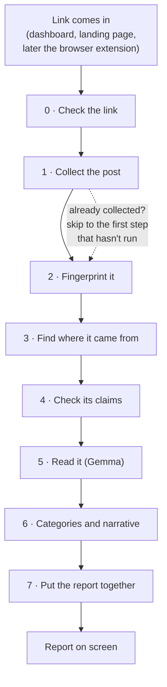

# The analysis cycle

What happens, step by step, when Veritas Lens analyzes a post. The goal is that anyone on the team can follow a post from the moment someone pastes its link to the report on screen.

**Speed is not a goal yet.** Every step runs one after the other, does one thing, and saves its result before the next step starts. That makes each step easy to understand, test and debug. We optimize later, once it all works.

There are two cycles:

1. **The analysis cycle.** Someone asks about one post. It runs on demand.
2. **The collection cycle.** Veritas Lens keeps collecting from the sources it follows, and regroups everything into narratives. It runs in the background on a schedule (built later).

## 1. The analysis cycle

| Step | Question it answers | Tool | Saved in | Shown on screen as |
|---|---|---|---|---|
| 0 · Check the link | Is this a Telegram, Facebook or news link we can read? | Our link parser | `analysis_requests` | An error under the link box, if not |
| 1 · Collect | What does the post say, who posted it, when? | **Oxylabs** (Facebook, Telegram), **context.dev** (news sites) | `posts`, `accounts`, `media`, `urls`, `scrape_jobs` | "Reading the post" |
| 2 · Fingerprint | What is it about, in a form we can compare across languages? | **EmbeddingGemma** (local) | Qdrant `posts` | "Making a text fingerprint" |
| 3 · Origin | Where else does the same story appear, and who said it first? | Qdrant search + platform data | `post_relations` | "Finding similar posts in every language" → *How it spread*, *Same story elsewhere* |
| 4 · Claims | What does it state as fact, and does that hold up? | **Gemma** + **context.dev** for source pages | `claims`, `post_claims`, `claim_evidence` | "Checking the claims" → *Claims in this post*, the verdict |
| 5 · Reading | What tone, intent and techniques does it use? | **Gemma** (local) | `post_analyses` | "Gemma reads the post" → *Gemma's reading*, underlined wording |
| 6 · Categories | Which categories and narrative does it belong to? | Qdrant (prototypes, cluster centres) + Gemma | `post_categories`, `post_clusters` | *Categories*, the cluster card |
| 7 · Report | Everything together | Our backend | `analysis_requests.result` | The full report |

**Rules that apply to every step**
- **A step only reads what earlier steps saved.** It never re-does their work. If the analysis stops halfway (server restart, AI down), it continues from the first step that hasn't finished.
- **Steps that already ran for this post are skipped.** The same link analyzed twice costs nothing the second time. A step is re-run only when its prompt or model version changes.
- **Every AI result records which model and prompt version produced it,** so results from different machines and prompt versions can be told apart.
- **Every failure has its own plain-language message** (listed per step below). The screen shows exactly that message.
- **Progress:** the analysis runs as a job. The screen asks every second which step it's on, and shows the step names from the table above.

### Step 0 · Check the link
- **Does:** recognises the platform and the post, for example `t.me/kanalas_b/4521` → Telegram, channel `kanalas_b`, message 4521. It writes every link to one standard form, so `https://`, `www.` and tracking parameters don't create duplicates. Then it records the request.
- **If it fails:** "That doesn't look like a Telegram or Facebook link…" Nothing else runs.

### Step 1 · Collect the post
- **Does:** if the post is already in the database, it uses that. Otherwise it fetches it:
  - **Oxylabs** for Facebook pages, groups and posts, and public Telegram channels.
  - **context.dev** for news sites, which returns the article as clean text (Markdown).

  It saves the text, author, place (channel, group or page), time, images, outbound links and engagement numbers. A forwarded or shared post also records where it came from, which gives step 3 a free, certain link.
- **Saved:** `posts` (author **and** the channel/group it appeared in), `accounts`, `post_metrics`, `media`, `urls`, and one `scrape_jobs` row per fetch.
- **If it fails:**
  - **Private or deleted post:** "This post is private or was removed, so it can't be analyzed."
  - **Scraper error or limit:** "We couldn't collect this post right now. Try again later."

### Step 2 · Fingerprint it
- **Does:** turns the post's text into 768 numbers with EmbeddingGemma, running locally. Posts that mean the same thing get similar numbers, even in different languages: a Lithuanian sentence and its English translation scored 0.81 in our test.
- **Saved:** a point in the Qdrant `posts` collection, with the same ID as the post in MySQL (`posts.uuid`).
- **If it fails:** "The local AI isn't running. Start Veritas Lens with the launcher."

### Step 3 · Find where it came from
- **Does:** finds the post's relatives and puts them in time order. Each kind of link is recorded with how it was found, and the earliest post is the origin:
  - **Certain links from the platform:** forwards and shares, from step 1.
  - **Identical text:** the same text hash, meaning an exact copy.
  - **Links to the same article.**
  - **Similar fingerprints in any language:** translation, near copy or paraphrase.
- **Saved:** `post_relations` (from → to, type, how it was detected, similarity).
- **If it fails:** the report still shows, with "We haven't found other copies yet."

### Step 4 · Check its claims
- **Does:**
  1. Gemma lists the checkable statements in the post.
  2. Each statement is compared with claims already checked (Qdrant `claims` collection). **Each claim is checked only once**, however many posts repeat it.
  3. A new claim gets checked: search for sources, fetch them with context.dev, and Gemma decides whether each source supports or contradicts the claim.
  4. The claim gets a verdict (true / false / misleading / unverified) with a confidence and a short explanation.
- **Saved:** `claims`, `post_claims`, `claim_evidence` (source, link, stance, quote).
- **Principle:** no evidence means **unverified**, never a guess. Every verdict shows the sources it's based on.
- **If it fails:** the claim stays unverified, and the report says the check couldn't run.

### Step 5 · Read it (Gemma)
- **Does:** Gemma reads the post and answers in a fixed JSON format:
  - **Tone,** for example alarmist.
  - **Likely intent.**
  - **Manipulation techniques,** each with the **exact wording** that shows it. A technique whose wording isn't actually in the post is dropped, so Gemma can't invent quotes.
  - **An English translation** for the reader.
- **Saved:** `post_analyses`, one row per analysis, with the model and prompt version.
- **If it fails:** the report shows everything else, plus "Gemma's reading isn't available right now."

### Step 6 · Categories and narrative
- **Does:**
  - **Categories:** compares the fingerprint with each category's example posts in Qdrant. Close calls are confirmed or rejected by Gemma.
  - **Cluster:** puts the post in the nearest existing cluster (narrative). The clusters themselves come from the collection cycle.
- **Saved:** `post_categories` (how it was matched: similarity or Gemma), `post_clusters`.
- **If it fails:** the post is shown as "not in a narrative yet."

### Step 7 · Put the report together
- **Does:** gathers the saved results into the report the screen shows: verdict, manipulation score, spread, earliest source, the post, how it spread, claims, similar posts, categories, Gemma's reading and the cluster. The shape is exactly `PostReport` in [frontend/src/api/types.ts](../frontend/src/api/types.ts).
- **Saved:** `analysis_requests.result`, so the same report opens instantly next time.

## 2. The collection cycle (later)

Runs in the background, on a schedule:

1. **Collect** new posts from the sources Veritas Lens follows (Oxylabs, context.dev), and save them (step 1 above).
2. **Fingerprint** every new post (step 2 above).
3. **Group into narratives** (clustering, after the backend's B8 phase):
   - UMAP + HDBSCAN group posts that say the same thing.
   - Each post gets its map position and how typical it is.
   - Gemma names each group from its 5 most typical posts.
   - Groups are linked to the same narrative from week to week.
4. **Check the claims** of the biggest and fastest-growing narratives first (step 4 above).

This is what fills the Narratives screen and the landing page's trending stories. The analysis cycle then reuses all of it, so a post from a known narrative is answered mostly from saved results.

## What runs where

| Part | Runs on | Needs internet |
|---|---|---|
| Link check, report | Our backend | No |
| Collecting (Oxylabs, context.dev) | Their services | Yes, and API keys in `.env` |
| Fingerprints, Gemma | This computer (llama-swap) | No |
| Similar-post search | This computer (Qdrant) | No |
| Saved results | This computer (MySQL) | No |

So once a post is collected, everything about it is analyzed **on the user's own computer**. Only collecting new posts and fetching evidence pages need the internet.
