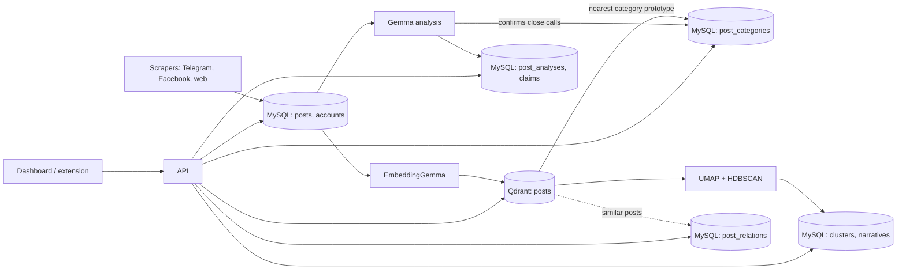

# Data architecture (draft v0.2)

Status: **draft, decisions from the first review applied.** Schema: [docker/mysql/init.sql](../docker/mysql/init.sql). Vector collections: [docker/qdrant/collections.json](../docker/qdrant/collections.json).

## Goal

The dashboard takes a link to a **post, profile, channel or group** and shows insights based on the data we already hold: who is behind it, how its content spread, which categories and narratives it falls into, and whether its claims hold up. The browser extension, which comes later, calls the same API with one click. The data model doesn't change for it.

## Decisions so far

| Topic | Decision |
|---|---|
| Platforms | **Telegram and Facebook first.** News sites (`web`) are needed for propagation chains. The others are seeded but not used yet. |
| Scope | **Any public post can be analyzed**, including posts by ordinary people, e.g. to check which category it falls into. Labelling *people* (bot scores and similar) is postponed. `account_assessments` exists but stays unused for now. |
| Retention | **Keep everything.** This is a hackathon build; storage can be optimized later. |
| Central vs. self-hosted | **The user chooses** (see below). The central server ships with the most data. |
| Analysis | **No existing tools: Gemma does the analysis.** Results go to `post_analyses`, tagged with the model and prompt version. |

## Two stores, two jobs

| | MySQL | Qdrant |
|---|---|---|
| Holds | Facts and relations: accounts, posts, full text, the propagation graph, analysis results, categories, claims, users, jobs | One 768-number vector per post, claim, category prototype and cluster centre, plus a few filter fields |
| Answers | "Who posted this, where, when, where did it come from, what did Gemma say?" | "What else says something similar, in any language?" |
| Source of truth | Yes | No. Everything in it can be rebuilt from MySQL by re-embedding |

The two are linked by a **deterministic UUID**: `posts.uuid` is the post's Qdrant point id. It's computed from the platform and the post's own id (`uuid5("telegram:post:-1001234567890/4521")`), so the central server and every self-hosted install produce the **same id for the same post**. Merging data between them never creates duplicates.

## Platform conventions

The `external_id` feeds the UUID, so the format must be identical on every install:

| Platform | Account `external_id` | Post `external_id` | Notes |
|---|---|---|---|
| Telegram | chat id, e.g. `-1001234567890` | `<chat_id>/<message_id>` | Forwards carry the original chat and message id, so we get a `forward` edge (`detected_by = platform`) for free. Channel comments live in the linked discussion group. |
| Facebook | page, group or profile id | `<owner_id>_<post_id>` | Shares point to the original post, giving a `repost` edge. Public pages are easy to scrape; groups and profiles often need a login, which is a scraping risk worth testing early. |
| Web | domain, e.g. `rt.com` | sha256(canonical URL) | Article author goes into `byline`. |

**Who wrote it vs. where it appeared.** In Telegram and Facebook groups these differ, so `posts` has two columns:
- `account_id`: the author, e.g. a member.
- `container_account_id`: the channel, group or page the post appeared in.

For a channel or page post, both point to the same account.

## The model in one page

**Who publishes**
- `actors`: real-world people and organizations, with `state_affiliation` (e.g. `RU` for RT).
- `accounts`: profiles, channels, groups, pages and websites, with `account_metrics` over time.
- `account_assessments`: reserved for later (see Scope).

**What is published**
- `posts`: full text, language, author and container, `content_hash` for exact copies, and `edited_at` (content changed after it spread).
  - `post_metrics`: views, shares and comments, plus `reactions` per emoji or reaction type. A pile of 😡 is a signal.
  - `media`: with a perceptual hash, so a reused picture can be found.
  - `urls` / `post_urls`: outbound links.

**How it spreads**
- `post_relations`: a directed graph from the earlier post to the later one (forward, repost, quote, reply, links_to, copy, translation, paraphrase), recording how each edge was detected.
- A recursive query walks the chain back to its origin, e.g. *RT article (EN) → Telegram channel A (RU) → channel B (LT)*.
- Content that is referenced but not scraped yet is a **stub**, so the chain never breaks.

**What category is it in**
- `categories`: a tree of topics, e.g. *anti-NATO*, *election interference*, *health misinformation*.
  - Each category has a description and example posts.
  - Together they make a **prototype vector** in the Qdrant `categories` collection.
- `post_categories`: a post is matched in two passes:
  1. **Embedding:** cosine similarity to each prototype. Instant and cheap, and runs on every post.
  2. **LLM:** Gemma reads the post and the category's description and confirms or rejects. Runs only when the first pass is close or uncertain.

  Both results are kept, with `method` set to `embedding` or `llm`, so we can measure how often they agree.
- `narratives`: specific, long-lived storylines inside a category, e.g. *"NATO troops provoke Belarus"* inside *anti-NATO*.
- `clustering_runs` → `clusters` → `post_clusters`: automatic groups of similar posts from each UMAP + HDBSCAN run. They work without knowing the content in advance and are linked to narratives once a person or Gemma names them.
  - `rank_in_cluster = 1` is the most typical post; the highest ranks are the edge cases.

**Is it true**
- `claims`: each checkable statement is stored once. The same claim in other posts or languages is found through Qdrant, so it's checked once.
- `post_claims`: which posts contain which claims.
- `claim_evidence`: sources found, each marked as supports or refutes.

**Gemma's analyses**
- `post_analyses`: one row per analysis per post: `analyzer` (e.g. `tone`), `analyzer_version` (the prompt version), `model` (e.g. `gemma-4-E4B-it`), a label, a score, and the full JSON answer in `details`.
  - Because the model and prompt version are recorded, results from different machines (which run different Gemma sizes) or from old prompts can be told apart and re-run.

**Dashboard plumbing**
- `users`: dashboard users.
- `analysis_requests`: "analyze this URL". It's both the job record and the user's history.
- `flags`: user reports.
- `scrape_jobs`: crawling tasks.

## What happens when someone pastes a link

1. Create an `analysis_requests` row, then work out the platform and the post or account id from the URL.
2. **Already known?** Show what we have immediately, then refresh in the background.
3. **Unknown?** Create a `scrape_jobs` row, then store the posts and accounts, and embed the posts into Qdrant.
4. **Enrich:**
   - nearest neighbours in Qdrant → copy/translation/paraphrase edges in `post_relations`
   - category prototypes → `post_categories`, with Gemma confirming close calls
   - nearest cluster centre → cluster and narrative
   - claims → match existing ones → verdict
   - Gemma analyses → `post_analyses`
5. Save the insights as `analysis_requests.result` and show them.

**Insights for a channel, group or page:**
- Posting volume and timing.
- Category and narrative mix.
- **Originator vs. amplifier ratio:** how often it's first in a chain.
- Share of near-copies of other accounts' posts, i.e. coordination.
- Linked domains and their owners' state affiliation.
- Reactions profile.
- Claim verdicts on its posts.

**Insights for a post:**
- Propagation chain back to the origin.
- The same story in other languages.
- Its categories, cluster and narrative.
- Claims with verdicts.
- Gemma's analyses.

## Central server vs. self-hosted: the user's choice

The schema is the same everywhere. What changes is where answers come from. This will be a launcher/app setting (e.g. `DATA_MODE` in `.env`):

| Mode | Behaviour |
|---|---|
| `central` | The dashboard uses our server's API and data. Nothing runs locally except the UI. |
| `hybrid` | Local AI and database. When local data is thin, it also asks the central API for neighbours and insights, and caches the answers locally with `origin = 'central'`. |
| `local` | Fully offline. Only the user's own scraped and analyzed data. Nothing leaves the machine. |

By default **nothing is sent up** from a self-hosted install, because a user's requests reveal what they read. Contributing data back can be an explicit opt-in later.

## Conventions

- **IDs and hashes:** integer keys are internal to one database. `uuid` is used across databases and as the Qdrant id. sha256 values are stored as `BINARY(32)`.
- **Time and encoding:** all times are UTC `DATETIME(3)`; text is `utf8mb4`.
- **Deletion:** hard deletes cascade (an account → its posts → edges, analyses, categories, flags). `deleted_at` allows soft deletes.
- **Embeddings:** EmbeddingGemma needs task prompts. Stored posts use the document prompt and searches use the query prompt (both recorded in `embedding_models`).
- **Qdrant naming:** collections are named per model (`posts__embeddinggemma_300m`) behind an alias (`posts`), so the model can be swapped without code changes.
- **`init.sql` is idempotent.** It was tested by running it twice on MySQL 8.4, plus sample-data tests for propagation chains, group posts, categories, constraints and cascades. All Qdrant definitions were validated against Qdrant 1.18.

## Still open (defaults are already in the schema)

1. **Logins on the central server:** public sign-up, or analysts only? Default: `users` with roles, and flags start as `open` until reviewed.
2. **Long articles:** default is one vector per article (title + opening). Chunk-level vectors can be added later.
3. **Journalists as their own entities (`actors`):** included. Remove if out of scope.
4. **Media files:** default is to store URLs, hashes and the extracted text, not the files.
5. **Emergency assistant** (first aid, war preparedness): not in this schema yet.
6. **Initial categories:** which ones do you want? I'd rather you name them than guess. Each needs a description and a few example posts.
